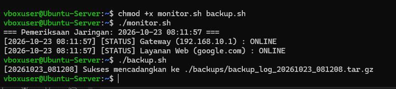

# Automated Network Monitoring & System Backup Script (Bash)

Repositori ini berisi skrip otomasi berbasis **Bash Shell** untuk lingkungan Linux (Ubuntu Server) yang berfungsi melakukan pemantauan (_monitoring_) ketersediaan jaringan gateway dan internet secara berkala, serta melakukan pencadangan (_backup_) data log sistem secara otomatis.

> Proyek mandiri untuk latihan administrasi sistem Linux, otomasi tugas IT Support, dan scripting Bash.

---

## 📌 Fitur Utama

1. **Pemantauan Ketersediaan Gateway (ICMP Ping):** Memeriksa ketersediaan router gateway (`192.168.10.1`) menggunakan perintah `ping`.
2. **Pemeriksaan Layanan Web (HTTP Curl):** Memverifikasi konektivitas akses internet ke domain publik (`google.com`) menggunakan utility `curl`.
3. **Pencatatan Log Terpusat (Logging):** Menyimpan status operasional sistem lengkap dengan cap waktu (_timestamp_) ke file `network_status.log`.
4. **Otomasi Pencadangan Data (Archiving):** Mengompresi dan mengarsipkan file log sistem ke format `.tar.gz` dengan penamaan tanggal dinamis untuk kebutuhan audit berkala.

---

## 🛠️ Struktur Skrip

```text
bash-network-monitoring/
├── README.md
├── scripts/
│   ├── monitor.sh          # Skrip pengecekan ketersediaan jaringan & web
│   └── backup.sh           # Skrip pencadangan log otomatis (tar.gz)
└── docs/
    └── screenshots/
        └── monitoring-test.png # Bukti eksekusi skrip
```

---

## 🚀 Cara Penggunaan

1. Berikan izin eksekusi pada kedua skrip:

```bash
chmod +x scripts/monitor.sh scripts/backup.sh
```

2. Jalankan skrip pemantauan jaringan:

```bash
./scripts/monitor.sh
```

3. Jalankan skrip pencadangan data log:

```bash
./scripts/backup.sh
```

---

## 🧪 Hasil Pengujian & Verifikasi

Eksekusi skrip berhasil mendeteksi status gateway, memverifikasi akses layanan web, dan melakukan kompresi data cadangan:



Cuplikan isi log pemantauan (`network_status.log`):

```text
[2026-10-23 08:11:57] [STATUS] Gateway (192.168.10.1) : ONLINE
[2026-10-23 08:11:57] [STATUS] Layanan Web (google.com) : ONLINE
```

---

## 👤 Penulis

- **Nama:** Naufal Naazhir Arkaan
- **Email:** [naufaljpr9@gmail.com](mailto:naufaljpr9@gmail.com)
